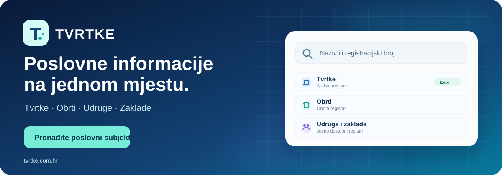
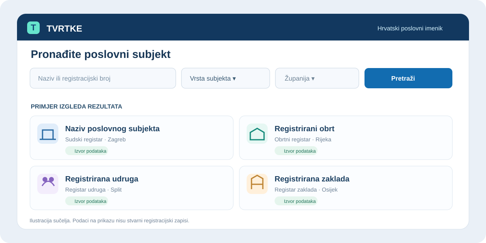
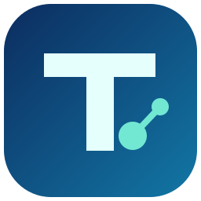

 

### 🇭🇷 Hrvatski poslovni imenik. Jednostavno, pregledno i na jednom mjestu.

**Pronađite informacije o poslovnim subjektima kroz više javnih registara Hrvatske.**

[🌐 Posjetite tvrtke.com.hr](https://tvrtke.com.hr) · [🪟 Windows aplikacija](https://github.com/bren-wp/Tvrtke/releases) · [🧩 WordPress dodatak](https://github.com/bren-wp/Tvrtke/releases)

---

## 🔎 Jedna tražilica. Više mogućnosti.

TVRTKE okuplja pretraživanje poslovnih subjekata u jednostavno, moderno sučelje. Bez nepotrebnih koraka pronađite naziv, registracijski broj, mjesto, djelatnost i ostale javno dostupne podatke iz **povezanih registara**.

| 🏢 Tvrtke | 🛍️ Obrti | 🤝 Udruge | 🌱 Zaklade |
|:--:|:--:|:--:|:--:|
| Subjekti Sudskog registra | Obrtni registar | Registar udruga | Registar zaklada |
| Naziv, OIB i MBS | Registracijski podaci | Osnovni podaci | Osnovni podaci |

*Dostupnost i obuhvat pojedine kategorije ovise o uspješno povezanim i uvezenim službenim izvorima. Nisu svi registri unaprijed uključeni u preuzimanje.*

## ✨ Sve što vam je potrebno za brže pretraživanje

| | |
| --- | --- |
| 🔍 **Pametna pretraga** | Pretražite naziv ili identifikator subjekta na jednom mjestu. |
| 🎛️ **Napredni filtri** | Suzite prikaz prema vrsti subjekta, županiji, djelatnosti i statusu. |
| 📋 **Pregledni profili** | Registracijski podaci, lokacija i raspoložive informacije iz izvora. |
| 🏷️ **Podrijetlo podataka** | Jasno naznačen registar i dostupna informacija o ažurnosti. |
| ⭐ **Favoriti na Windowsu** | Spremite subjekte koje najčešće provjeravate. |
| 📁 **CSV izvoz** | Izvezite trenutačno prikazane rezultate iz Windows aplikacije. |
| 📱 **Mobilni prikaz** | WordPress tražilica prilagođava se telefonu, tabletu i računalu. |
| 🔐 **Sigurna veza** | Windows i WordPress komuniciraju s centralnim API-jem putem HTTPS-a. |

## 🖼️ Jednostavno sučelje, jasni rezultati

Vizualna ilustracija korisničkog iskustva; nazivi i kartice nisu stvarni zapisi iz registara.

## 🪟 TVRTKE za Windows

Svakodnevni rad s poslovnim informacijama na velikom ekranu, uz preglednu tražilicu, profile, favorite i CSV izvoz.

**Odaberite način korištenja:**

- **Setup.exe** — klasična instalacija s prečacem i mogućnošću deinstalacije.
- **Portable.exe** — pokretanje bez klasične instalacije.

[⬇️ Preuzmite Windows aplikaciju](https://github.com/bren-wp/Tvrtke/releases)

## 🧩 TVRTKE za WordPress

Dodajte profesionalnu tražilicu poslovnih subjekata na svoju WordPress stranicu.

**Što dobivate?** Gutenberg blok, shortcode `[tvrtke_pretraga]`, responzivni prikaz, profile i filtre za jednostavno pregledavanje dostupnih registara.

[⬇️ Preuzmite WordPress dodatak](https://github.com/bren-wp/Tvrtke/releases)

## 💙 Izgrađeno za Hrvatsku

TVRTKE je neovisna aplikacija koja objedinjuje informacije iz povezanih javnih izvora kako bi pretraživanje bilo ugodnije i preglednije.

**Službeni izvori:** [Sudski registar](https://sudreg-data.gov.hr/) · [Otvoreni podaci RH](https://data.gov.hr/) · [Preglednik Obrtnog registra](https://pretrazivac-obrta.gov.hr/)

> **Napomena o točnosti:** TVRTKE nije službeni državni servis. Podaci su informativni. Pojedini izvori mogu biti nedostupni, djelomično uvezeni ili vremenski neusklađeni. Za službene pravne postupke provjerite podatke u izvornom registru.

---

**TVRTKE · Poslovni imenik Hrvatske**

[tvrtke.com.hr](https://tvrtke.com.hr) · [Izdanja](https://github.com/bren-wp/Tvrtke/releases) · [Podrška](https://github.com/bren-wp/Tvrtke/issues)

© Brendigo · MIT

